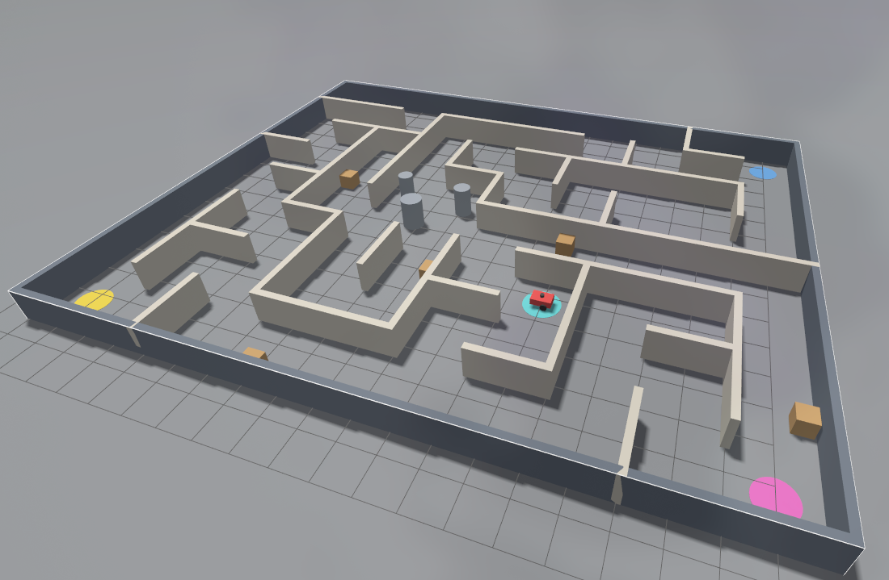
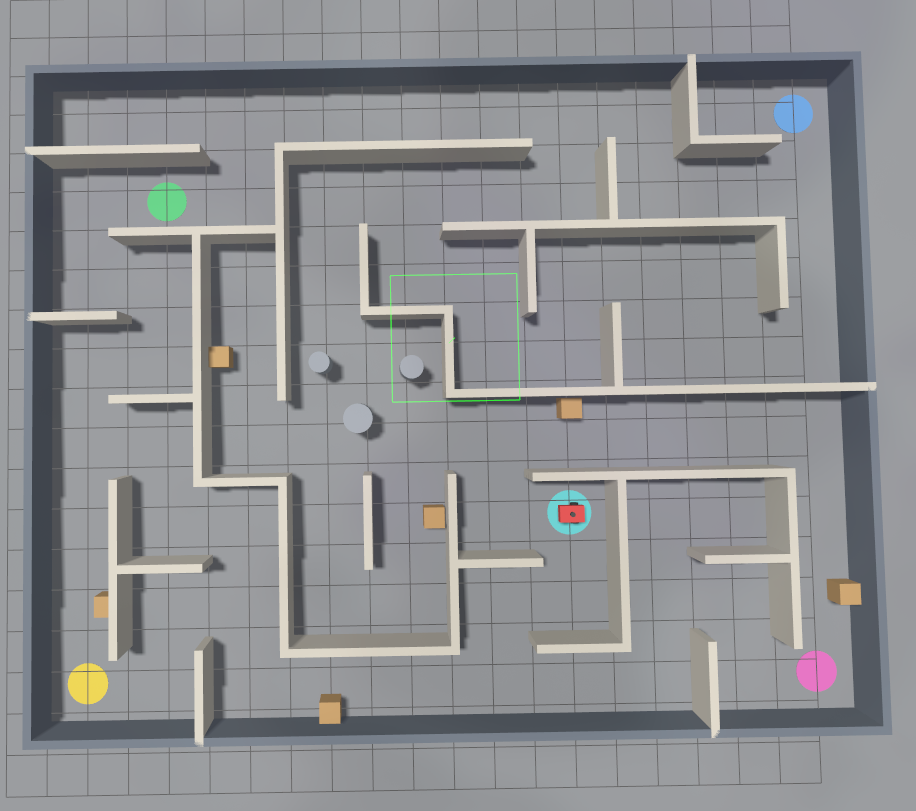
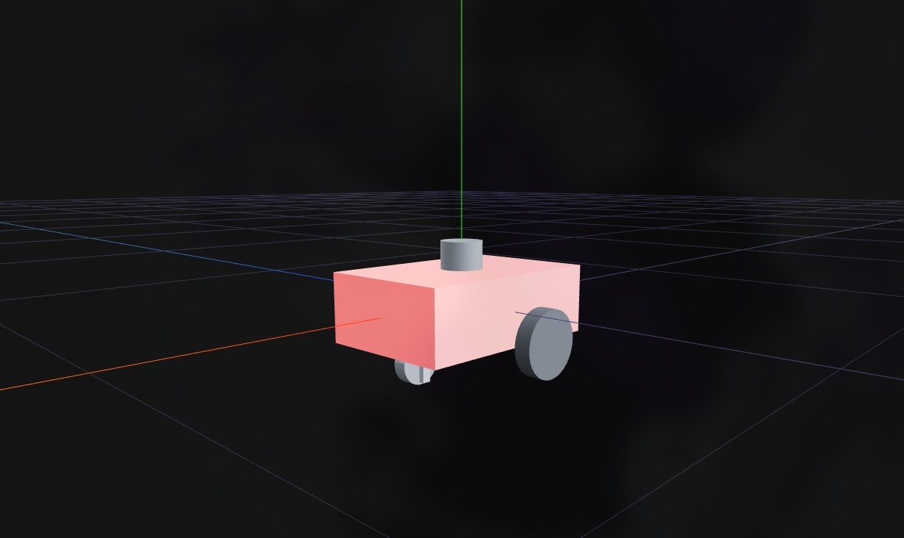
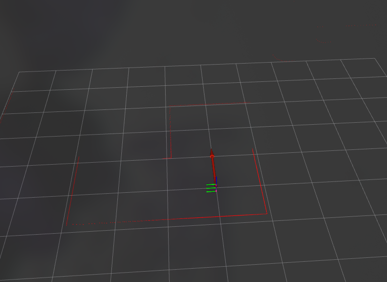
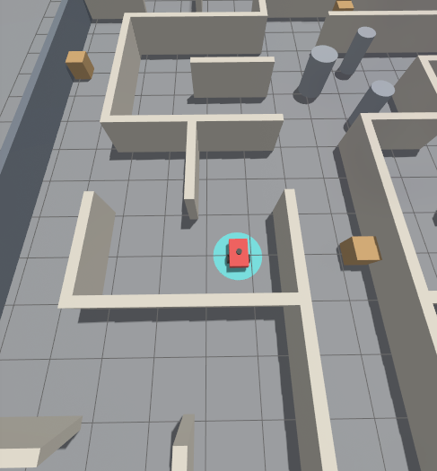
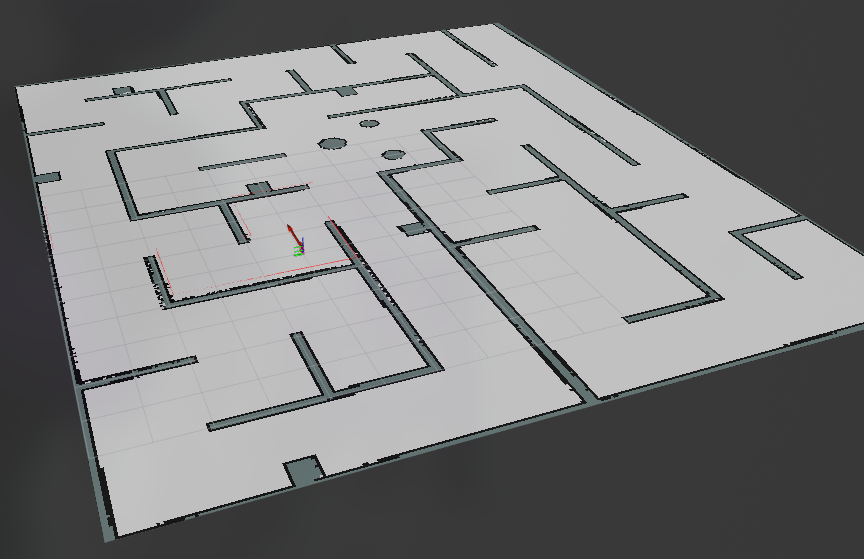
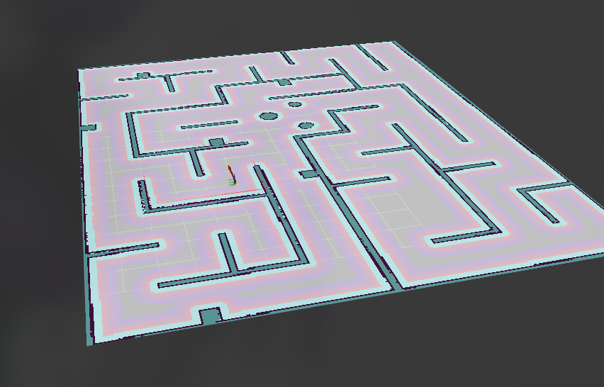
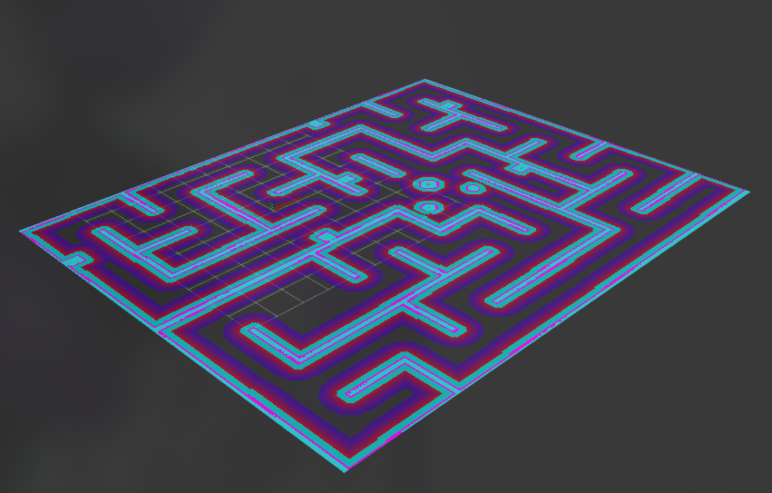
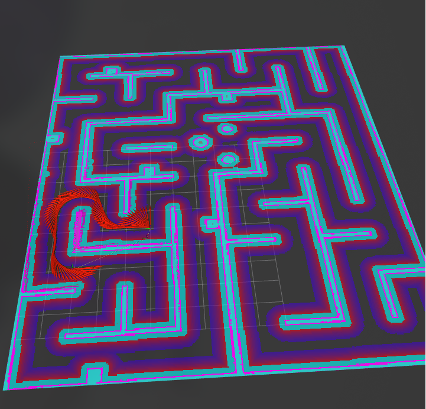
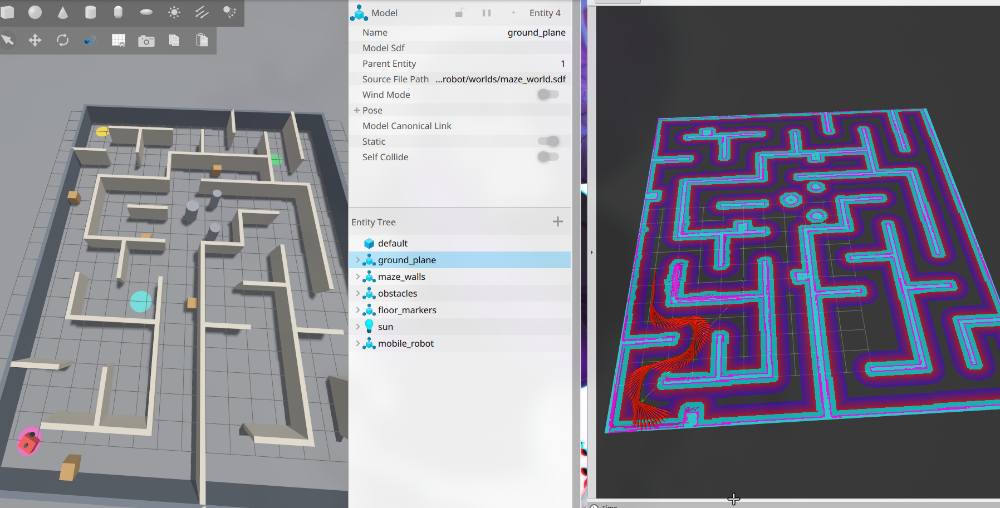

# ROS 2 Differential-Drive Robot Simulation

A simulated differential-drive mobile robot built with **ROS 2 Jazzy, Gazebo Harmonic, and Nav2**, operating in a custom maze environment with LiDAR perception, odometry, TF, SLAM mapping, and map-based autonomous navigation.

The goal of this project is to build and understand a complete mobile robotics pipeline, from robot modeling and sensor integration to localization and goal-based navigation.

<!-- Replace the links below with your repository's actual media. -->

<!-- <p align="center">
  
</p>

<p align="center">
  <a href="YOUR_DEMO_VIDEO_URL"><strong>▶ Watch the Simulation Demo</strong></a>
</p> -->

<p align="center">
  
  
  
  
</p>

---

## Demo

- will be added soon . 


---

## Table of Contents

- [Overview](#overview)
- [Features](#features)
- [Demo and Screenshots](#demo-and-screenshots)
- [System Architecture](#system-architecture)
- [Technology Stack](#technology-stack)
- [Project Structure](#project-structure)
- [Prerequisites](#prerequisites)
- [Installation](#installation)
- [Running the Simulation](#running-the-simulation)
- [Mapping](#mapping)
- [Important ROS Topics](#important-ros-topics)
- [Known Issues](#known-issues)
- [What I Learned](#what-i-learned)
- [Future Improvements](#future-improvements)
- [Acknowledgements](#acknowledgements)

## Overview

This project implements a simulated two-wheel differential-drive robot inside a custom maze world using Gazebo Harmonic.

The robot moves using a differential-drive motion model. A simulated 2D LiDAR provides range measurements of nearby obstacles, while odometry and TF provide the coordinate relationships required by the navigation stack.

The project brings together robot description, simulation, sensor data, map representation, localization, and autonomous navigation in one robotics workflow.

### Project objectives

- Build and simulate a mobile robot using a custom Xacro/URDF model.
- Understand differential-drive motion and robot odometry.
- Integrate a simulated LiDAR and inspect its data.
- Establish and validate the robot's TF frame hierarchy.
- Create, save, and load an occupancy-grid map of the maze.
- Integrate Nav2 for goal-based navigation and obstacle-aware planning.
- Develop a foundation for more advanced robotics projects.

## Features

- **Custom maze environment:** A purpose-built Gazebo world with walls, crates, and pillars.
- **Differential-drive motion:** Independent left and right wheel control for forward, reverse, and rotational movement.
- **LiDAR perception:** Simulated 2D laser scans published to ROS 2.
- **Odometry:** Robot motion published as odometry data.
- **TF integration:** Coordinate frames connecting odometry, robot body, and sensor.
- **Occupancy-grid mapping:** SLAM Toolbox mapping and a saved map of free, occupied, and unknown space.
- **Nav2 integration:** AMCL localization, costmaps, planning, and control (MPPI controller).
- **RViz2 visualization:** Robot model, map, sensor data, TF, and navigation state.
- **Modular launch and configuration files:** Separate simulation, mapping, navigation, and velocity-multiplexer launch files.

## Screenshots

### 1. Simulation environment




*The robot operating inside the custom maze world in Gazebo Harmonic.*

### 2. Robot model



*The robot model and its simulated sensor configuration.*

### 3. LiDAR perception

  

*LiDAR range measurements visualized in RViz2.*

### 4. Map and costmap visualization




*The maze occupancy grid and navigation costmap visualization.*

### 5. Autonomous navigation




*The robot navigating toward a selected goal in the simulated environment.*


## System Architecture

The system is organized into a simulation layer, a sensor and state-estimation layer, and a navigation layer.

```text
                 Gazebo Harmonic
                Custom Maze World
                        |
                  Robot Simulation
                        |
           +------------+------------+
           |                         |
    Differential Drive          2D LiDAR
           |                         |
        /odom                     /scan
           |                         |
           +------------+------------+
                        |
                   ROS 2 Topics
                        |
                 TF Transform Tree
                        |
              +---------+---------+
              |                   |
         Map / AMCL          Nav2 Navigation
              |                   |
              +---------+---------+
                        |
                Goal-Based Motion
                        |
                   Robot Motion
```

The exact data flow depends on the launch configuration and the active mode (mapping or navigation).

### Velocity command flow

```text
Nav2 controller -> velocity smoother -> /cmd_vel_smoothed -> twist_mux -> /cmd_vel -> ros_gz_bridge -> Gazebo DiffDrive
```

Teleoperation can feed `twist_mux` through `/cmd_vel_teleop` (higher priority). The exact routing depends on the Nav2 launch and remapping configuration and should be verified at runtime.

### Coordinate frames

The intended transform structure is:

```text
map
 └── odom
      └── base_footprint
           └── base_link
                └── lidar_link
```

- `map`: Global frame used for map-based localization and navigation.
- `odom`: Locally continuous odometry reference frame.
- `base_footprint`: Ground-projected robot reference frame.
- `base_link`: Main robot body frame.
- `lidar_link`: LiDAR sensor frame.

The actual hierarchy should be verified against the robot description and the runtime TF tree (`ros2 run tf2_tools view_frames`).

### Mapping and localization

| Component | Role |
|---|---|
| SLAM Toolbox | Builds a new map (mapping mode) or localizes against a serialized map. |
| Map server | Loads the saved occupancy-grid map. |
| AMCL | Estimates the robot's pose within the saved map. |
| Nav2 | Coordinates planning, control, and navigation to goals. |

AMCL and SLAM Toolbox localization must not run at the same time, because both publish the `map → odom` transform.

## Technology Stack

| Component | Technology |
|---|---|
| Operating system | Ubuntu 24.04 in Distrobox |
| Robotics middleware | ROS 2 Jazzy |
| Physics simulation | Gazebo Harmonic |
| Robot description | URDF / Xacro |
| Robot state and transforms | `robot_state_publisher`, TF2 |
| Sensor | Simulated 2D LiDAR |
| Mapping | SLAM Toolbox |
| Localization | AMCL |
| Autonomous navigation | Nav2 |
| Visualization | RViz2 |
| Simulation integration | `ros_gz_sim`, `ros_gz_bridge` |
| Launch system | Python launch files |
| Configuration | YAML and SDF |

## Project Core Structure

```text
mobile_robot/
├── launch/
│   ├── gazebo_model.launch.py
│   ├── mapping.launch.py
│   ├── navigation.launch.py
│   └── twist_mux.launch.py
│
├── model/
│   ├── robot.xacro
│   └── robot.gazebo
│
├── config/
│   ├── nav2_params.yaml
│   ├── slam_mapping_params.yaml
│   ├── mapper_params_online_async.yaml
│   └── twist_mux.yaml
│
├── parameters/
│   └── build_params.yaml
│
├── worlds/
│   └── maze_world.sdf
│
├── maps/
│   ├── maze_map_save.yaml
│   ├── maze_map_save.pgm
│   ├── maze_map_serial.data
│   └── maze_map_serial.posegraph
│
├── resource/
│   └── mobile_robot
│
├── setup.py
└── package.xml
```

Adjust this layout if your final repository contains additional or differently named files.

### Key files

| File | Purpose |
|---|---|
| `model/robot.xacro` | Robot links, joints, geometry, and sensor mounting structure. |
| `model/robot.gazebo` | Gazebo plugins (DiffDrive, joint states) and LiDAR sensor definition. |
| `worlds/maze_world.sdf` | The maze simulation environment. |
| `launch/gazebo_model.launch.py` | Launches Gazebo, robot state publisher, spawn, bridge, and RViz2. |
| `launch/mapping.launch.py` | Launches SLAM Toolbox in mapping mode. |
| `launch/navigation.launch.py` | Launches Nav2 with the saved map and navigation parameters. |
| `launch/twist_mux.launch.py` | Launches velocity-command multiplexing. |
| `parameters/build_params.yaml` | ROS–Gazebo topic bridge definitions. |
| `config/nav2_params.yaml` | Nav2, AMCL, controller, and costmap settings. |
| `config/slam_mapping_params.yaml` | SLAM Toolbox parameters for mapping mode. |
| `config/mapper_params_online_async.yaml` | SLAM Toolbox parameters for localization mode. |
| `config/twist_mux.yaml` | Velocity input priorities and timeouts. |
| `maps/maze_map_save.*` | Saved occupancy-grid map used by the map server. |
| `maps/maze_map_serial.*` | Serialized SLAM Toolbox state files. |

## Prerequisites

Developed for the following environment:

- Ubuntu 24.04 (a Distrobox container on a CachyOS / Hyprland host)
- ROS 2 Jazzy
- Gazebo Harmonic
- Python 3
- Xacro and `robot_state_publisher`
- `ros_gz_sim` and `ros_gz_bridge`
- Nav2 (including AMCL), SLAM Toolbox, and `twist_mux`
- RViz2

The commands below assume ROS 2 Jazzy is installed at `/opt/ros/jazzy`. If you use Distrobox, run them inside the Ubuntu container.

> **Environment note:** On Wayland compositors such as Hyprland, the launch file sets `QT_QPA_PLATFORM=xcb` and `GZ_IP=127.0.0.1` so the Gazebo GUI and transport work correctly. These are set in `gazebo_model.launch.py`.

## Installation

### 1. Source ROS 2

```bash
source /opt/ros/jazzy/setup.bash
```

### 2. Create or enter the workspace

```bash
mkdir -p ~/ros2_ws/src
cd ~/ros2_ws/src
git clone <This_github_repo_URL> mobile_robot
```

If the repository is already local, use its existing location.

### 3. Install dependencies

```bash
cd ~/ros2_ws
rosdep update
rosdep install --from-paths src --ignore-src -r -y
```

### 4. Build the workspace

```bash
cd ~/ros2_ws
colcon build --symlink-install
source ~/ros2_ws/install/setup.bash
```

In every new terminal, source both ROS 2 and the workspace overlay.

## Running the Simulation

### 1. Launch Gazebo and the robot

```bash
source /opt/ros/jazzy/setup.bash
source ~/ros2_ws/install/setup.bash

ros2 launch mobile_robot gazebo_model.launch.py
```

This starts Gazebo with the maze world, spawns the robot, starts the ROS–Gazebo bridge, and opens RViz2.

### 2. Launch navigation

In a separate terminal:

```bash
source /opt/ros/jazzy/setup.bash
source ~/ros2_ws/install/setup.bash

ros2 launch mobile_robot navigation.launch.py
```

Wait for Nav2 to finish initializing.

### 3. Start the velocity multiplexer (if used)

In another terminal:

```bash
ros2 launch mobile_robot twist_mux.launch.py
```

### 4. Initialize the robot pose

With AMCL, set the initial pose using RViz2's **2D Pose Estimate** tool, with RViz's **Fixed Frame set to `map`**. AMCL rejects initial poses given in any other frame.

> The saved map's origin is anchored relative to the robot's spawn pose, so the map frame is not identical to the Gazebo world frame. Place the estimate where the robot appears on the loaded map, not at its Gazebo world coordinates.

### 5. Send a navigation goal

Use RViz2's **2D Goal Pose** tool to select a target position and orientation.

> **Note:** Successful node startup does not guarantee correct localization or navigation. Verify the TF tree, costmaps, and goal-completion behavior at runtime.

## Mapping

To build a new map with SLAM Toolbox:

```bash
# Terminal 1
ros2 launch mobile_robot gazebo_model.launch.py

# Terminal 2
ros2 launch mobile_robot mapping.launch.py
```

Drive the robot through the maze (for example with a teleop node publishing to `/cmd_vel_teleop`), then save the map:

```bash
ros2 run nav2_map_server map_saver_cli -f ~/ros2_ws/src/mobile_robot/maps/maze_map_save
```

**NOTE : Do not run SLAM Toolbox and AMCL together; both publish `map → odom`.**

## Important ROS Topics

| Topic | Type / Purpose |
|---|---|
| `/clock` | Simulation time from Gazebo. |
| `/cmd_vel` | Final velocity command sent to the Gazebo drive plugin. |
| `/cmd_vel_smoothed` | Smoothed Nav2 velocity command (input to `twist_mux`). |
| `/cmd_vel_teleop` | Teleoperation command (highest priority in `twist_mux`). |
| `/odom` | Odometry from the Gazebo differential-drive plugin. |
| `/scan` | 2D LiDAR range measurements. |
| `/tf`, `/tf_static` | Dynamic and static coordinate transforms. |
| `/map` | Saved occupancy-grid map. |
| `/global_costmap/costmap` | Global navigation costmap. |

Active topic names depend on the launch and remapping configuration.

Useful inspection commands:

```bash
ros2 topic list
ros2 topic info /cmd_vel --verbose
ros2 topic echo /odom --once
ros2 run tf2_tools view_frames
ros2 run tf2_ros tf2_echo map odom
```

## Known Issues

Active debugging items, tracked openly:

- **Spinning after goal arrival:** The robot sometimes keeps rotating near the goal instead of stopping. Under investigation: command routing between the velocity smoother, collision monitor, and `twist_mux`, plus controller and goal-checker behavior.
- **Odometry / localization consistency:** Pose estimates can disagree with the robot's true pose. Suspects include initial-pose frame and coordinates, wheel friction, and sensor update rates.
- **Initial-pose warnings:** AMCL may report frame and timestamp-extrapolation warnings if the pose is set in the wrong frame or before TF is available.
- **RViz SLAM Toolbox message:** "Waiting for the slam_toolbox node configuration" appears when RViz loads a config containing the SLAM Toolbox panel while SLAM Toolbox is not running. It is harmless in navigation mode.

## What I Learned

- Differential-drive kinematics and mobile robot motion.
- Robot modeling with URDF and Xacro.
- Gazebo simulation and physical interactions.
- ROS 2 topics, launch files, and parameter configuration.
- LiDAR integration and sensor-frame transforms.
- TF frame relationships and odometry.
- Occupancy-grid maps and map metadata.
- SLAM Toolbox and AMCL workflows.
- Nav2 planning, costmaps, and goal-based control.
- Debugging distributed robotics systems across multiple ROS nodes.

## Future Improvements

- Validate odometry against simulated ground truth.
- Verify reliable stopping and orientation convergence at goals.
- Improve obstacle avoidance in more complex environments.
- Add a simulated RGB camera for visual perception.
- Refine chassis, wheel, and caster geometry with correct inertias.
- Add automated navigation tests and quantitative performance measurements.
- Experiment with sensor fusion, visual perception, and more advanced autonomy.

## Acknowledgements

Built as a hands-on robotics learning project using the ROS 2, Gazebo, and Nav2 ecosystems.

Feedback, suggestions, and contributions are welcome.
